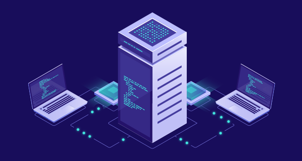

<p align="center">
  
</p>

<h1 align="center">Secullum RH — API Requests</h1>

<p align="center">
  Coleção aberta para a comunidade testar e validar a <strong>API de Integração Externa do Secullum RH</strong> com o <a href="https://www.usebruno.com/"><strong>Bruno</strong></a>. Use como convier!
</p>

<p align="center">
  
  
  
  
</p>

---

## 🎯 Sobre o projeto

Este repositório reúne as requisições da integração externa do **Secullum RH** de forma organizada e pronta para uso no dia a dia:

- **Foco total no Bruno (OpenCollection YAML):** todas as requests vivem como arquivos `.yml` organizados por módulo na pasta [`bruno/`](./bruno/).
- **Pronto para clicar em "Send":** filtros opcionais de listagens já vêm desabilitados por padrão para você listar registros com 1 clique e ativar filtros só quando precisar.
- **Autenticação automática:** ao rodar `Token` e `Listar Bancos`, o token e o banco selecionado são preenchidos automaticamente nas demais requests.
- **Fácil de manter atualizado:** atualize o repositório com um simples `git pull` e o Bruno carrega as novidades na hora, sem reimportar nada.

---

## ⚡ Início Rápido no Bruno

> Novo no Bruno? Veja o passo a passo completo em **[Guia de Início Rápido no Bruno](./docs/guia-inicio-rapido-bruno.md)**.

1. **Instale o Bruno** em [usebruno.com](https://www.usebruno.com/downloads) (versão 3.x+ recomendada).
2. **Clone este repositório** em uma pasta fixa do seu computador:
   ```bash
   git clone https://github.com/luizGDpulz/secullum-rh-api-requests.git
   ```
3. **Abra a coleção no Bruno:** clique em **Open Collection** e selecione a pasta `bruno/` dentro do repositório clonado.
4. **Configure suas credenciais sem sujar o Git:**
   - No Bruno, selecione o environment **Secullum Ponto Web (Produção)** (ou crie uma cópia local chamada `Producao.local.yml`, já ignorada pelo `.gitignore`).
   - Preencha `username` e `password`.
5. **Autentique e selecione o banco:**
   - Rode `01-autenticacao-e-selecao-de-banco` → **`01-token`** (salva `access_token` automaticamente).
   - Rode `01-autenticacao-e-selecao-de-banco` → **`03-listar-bancos`** (salva `selected_bank_id` e lista todos os bancos no **Console** do Bruno).
6. **Teste qualquer endpoint** das pastas `02` a `21`!

---

## 🔄 Como manter atualizado

Como o Bruno lê os arquivos `.yml` diretamente da pasta do seu computador, **você não precisa ficar reimportando coleções**:

1. Abra o terminal na pasta do projeto (ou use o **GitHub Desktop** / **VS Code**) e rode:
   ```bash
   git pull
   ```
2. Pronto! Todas as novas requests, correções de payload e atualizações do Swagger aparecem automaticamente no Bruno.

> **Dica de ouro:** Nunca salve sua senha dentro de arquivos versionados se for fazer `git pull` direto — use um environment `*.local.yml` (ignorado pelo Git). Veja os detalhes no **[Guia de Atualização](./docs/guia-atualizacao-suporte.md)**.

---

## 📚 Guias de Uso

| Guia | Para que serve |
| :--- | :--- |
| 🚀 **[Início Rápido no Bruno](./docs/guia-inicio-rapido-bruno.md)** | Instalação, clone, configuração segura de credenciais e primeiro teste passo a passo. |
| 🔄 **[Como Manter Atualizado](./docs/guia-atualizacao-suporte.md)** | Fluxo recomendado com `git pull` (terminal, GitHub Desktop ou sem Git via Release ZIP). |
| 🛠️ **[Troubleshooting & Dicas](./docs/guia-troubleshooting.md)** | Solução rápida para erro 401, troca de banco, filtros opcionais e divergências Swagger × PDF. |

---

## 🗂️ Estrutura da Coleção

```text
bruno/
├── 01-autenticacao-e-selecao-de-banco/   # Token, Reivindicações e Listar Bancos
├── 02-atividades/                        # Cadastro e listagem de atividades
├── 03-atividades-lancamentos/            # Lançamentos de atividades
├── 04-batidas/                           # Consulta de batidas
├── 05-calculos/                          # Cálculos e totais
├── 06-cartao-ponto/                      # Ajustes no cartão ponto
├── 07-departamentos/                     # Departamentos
├── 08-empresas/                          # Empresas
├── 09-equipamentos/                      # Equipamentos (REPs)
├── 10-estruturas/                        # Estruturas, funcionários e responsáveis
├── 11-fonte-de-dados/                    # Fonte de dados e leitura incremental
├── 12-funcionarios/                      # Funcionários (PIS, CPF e foto)
├── 13-afastamentos/                      # Afastamentos (PIS e CPF)
├── 14-funcoes/                           # Funções
├── 15-operacoes-auxiliares/              # Gravar logs e iniciar backup
├── 16-horarios/                          # Horários
├── 17-incluir-ponto/                     # Configurações, inclusão e pendências
├── 18-justificativas/                    # Justificativas
├── 19-motivos-de-demissao/               # Motivos de demissão
├── 20-perguntas-adicionais/              # Perguntas adicionais
├── 21-ponto-offline/                     # Assinatura de arquivo Ponto Offline
└── environments/
    └── Producao.yml                      # Variáveis padrão da API
```

---

## 📮 Uso Alternativo no Postman (Secundário)

> O foco principal deste repositório é o **Bruno**. Os arquivos do Postman são mantidos em [`postman/`](./postman/) apenas como alternativa secundária para quem ainda não migrou.

- Collection: [`postman/secullum-ponto-web.postman_collection.json`](./postman/secullum-ponto-web.postman_collection.json)
- Environment: [`postman/secullum-ponto-web.postman_environment.json`](./postman/secullum-ponto-web.postman_environment.json)

No Postman, é necessário **reimportar** os arquivos JSON manualmente sempre que houver atualização no repositório.

---

## 🔗 Referências Oficiais & Notas da API

- **Swagger UI:** [pontowebintegracaoexterna.secullum.com.br/docs/index.html](https://pontowebintegracaoexterna.secullum.com.br/docs/index.html)
- **Swagger JSON:** [pontowebintegracaoexterna.secullum.com.br/swagger/v1/swagger.json](https://pontowebintegracaoexterna.secullum.com.br/swagger/v1/swagger.json)
- **Manual PDF Oficial (Secullum):** [Integracao_Externa_Ponto_Web.pdf](https://github.com/Secullum/PontoWebIntegracaoExternaExemplo/blob/master/Integracao_Externa_Ponto_Web.pdf)

> **Nota de referência:** Collection validada contra o [Swagger vivo](https://pontowebintegracaoexterna.secullum.com.br/swagger/v1/swagger.json) em `27/11/2026`. Em caso de divergência entre o manual PDF antigo e o Swagger atual, **a collection prioriza o Swagger vivo** (ex.: `IntegracaoExterna/Pendencias` foi removida no Swagger atual; `GravarLogsIniciarBkp` e `PontoOffline/AssinaturaArquivo/Assinar` existem no Swagger e não constam no PDF).
